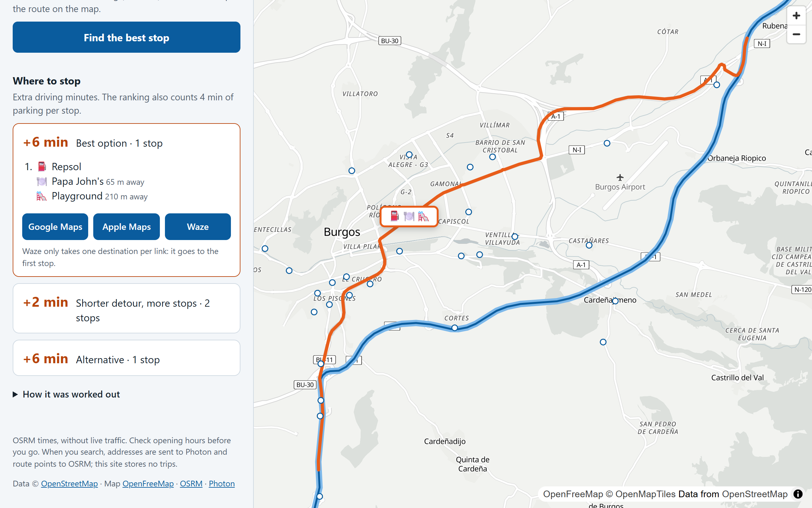
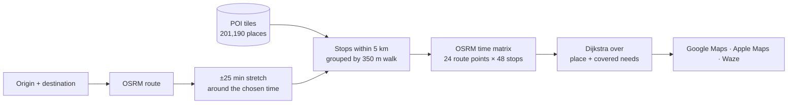

<div align="center">

# 🛣️ Route Detour Optimizer

**Say what you need on a road trip and find the stop that costs you the least time, with a multi-need Dijkstra that runs in the browser.**


[What it does](#-what-it-does) · [How it works](#-how-it-works) · [Quick start](#-quick-start) · [Design decisions](#-design-decisions) · [Limits](#-limits)

</div>



---

## ✨ What it does

Pick up to four needs (fuel, EV charging, gluten-free food, a playground, truck parking, a campervan site...), choose when you want to stop, and the app finds the stop, or combination of stops, that adds the least driving. Then it opens the trip in Google Maps, Apple Maps or Waze.

It runs on phones and desktops, can be installed, and needs no API keys, accounts or backend of its own. A demo video is in [`videos/route-detour-optimizer.mp4`](videos/route-detour-optimizer.mp4).

## 🧠 How it works

Plain Dijkstra answers "what is the shortest path?". The question here is "where do I stop to refuel, eat and let the kids play while losing the least time?". Each graph state is **(place, needs already covered)**: with 72 places and 4 needs, at most 1,152 states. The shortest path decides at once which stops to make, in which order, where to leave the route and where to rejoin it.



The algorithm is in [`src/core/dijkstra.ts`](src/core/dijkstra.ts). The tests compare it with brute force on 200 random graphs. On the recorded example trips, the detour differs by 0.2 to 1.1 minutes from a full route through the stops.

## 🚀 Quick start

Requires Node.js 24 (the version used to build and test it).

```bash
npm install
npm run dev        # development server
npm test           # tests
npm run build      # outputs dist/
npm run data:pois  # refresh the OpenStreetMap catalogue
npm run data:demo  # record the example trips again
```

`dist/` is a static site: it can be hosted on GitHub Pages, Vercel or Netlify.

## 🧭 Design decisions

- **Own catalogue**: 201,190 places in Spain, split into tiles (7.4 MB in total; only the ones along the stretch are downloaded). The public Overpass API failed when tested.
- **No Google Places content**: its European terms restrict showing that content on maps.
- **Recorded examples**: the demo opens even when OSRM is down, and offline once visited.
- **Waze** documents one destination per link, so it goes to the first stop. Google and Apple Maps keep the stops and the destination.

## ⚠️ Limits

- Spain only, with no live traffic or opening hours.
- Walking distances are straight lines.
- OpenStreetMap has gaps: for example, only 857 places are tagged gluten-free.
- OSRM and Photon are public demo servers: fine for a portfolio, not for a high-traffic product.

## 🙏 Credits

Data © [OpenStreetMap](https://www.openstreetmap.org/copyright) contributors (ODbL), downloaded with QLever. Map: OpenFreeMap and MapLibre. Routing: OSRM. Addresses: Photon.
